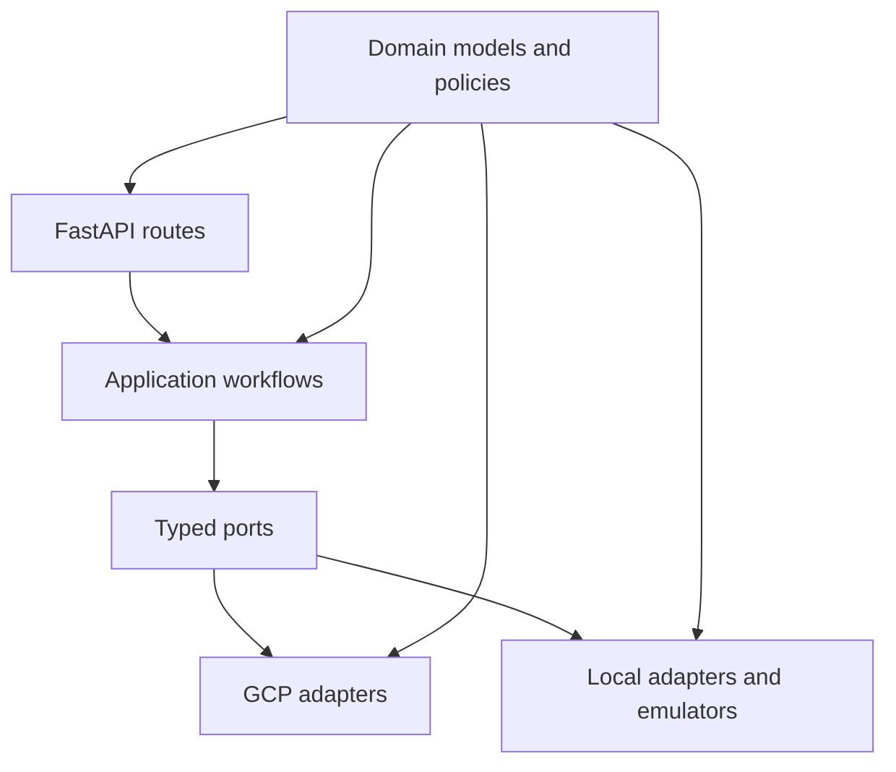
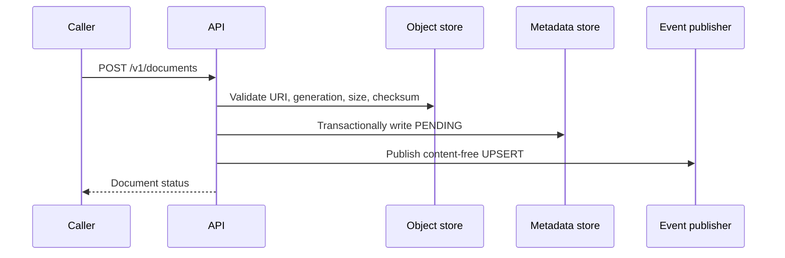

# Codebase guide

This guide explains where behavior lives and how a request moves through the
repository. Read it before changing code.

## Start here

Recommended reading order:

1. `README.md` — supported commands and current scope.
2. `docs/local-development.md` — how the runnable environment fits together.
3. `packages/rag_core/models.py` — shared data structures and states.
4. `services/api/app/main.py` — API composition and routes.
5. `services/worker/app/main.py` — worker composition and ingestion endpoint.
6. `packages/rag_core/retrieval.py` and
   `services/worker/app/service.py` — the two main application workflows.
7. `local/emulator/wiring.py` — concrete local dependency wiring.

## Layout

```text
.
├── services/
│   ├── api/app/                 HTTP API and authentication
│   └── worker/app/              Pub/Sub push worker and ingestion workflow
├── packages/rag_core/           Shared domain code, ports, and GCP adapters
├── contracts/                   OpenAPI and runtime configuration schemas
├── tests/                       Production application and adapter tests
├── local/                       Compose, emulators, local wiring, scripts, and tests
├── docs/                        Architecture and operating guides
├── Dockerfile.api              API image
├── Dockerfile.worker           Worker image
├── pyproject.toml              Dependencies and quality-tool configuration
└── Makefile                    Stable development commands
```

## Layers and dependencies



The important rule is that routes and workflows depend on typed interfaces,
not directly on SDK clients:

- `MetadataStore` hides Firestore.
- `ObjectStore` hides Cloud Storage.
- `EventPublisher` hides Pub/Sub.
- `EmbeddingModel` hides Vertex embeddings.
- `VectorIndex` hides Vertex AI Vector Search.
- `Generator` hides Gemini.

Local and GCP implementations share these interfaces. Business rules should not
branch on provider-specific SDK types.

## API service

Entry point: `services/api/app/main.py`.

`create_app()`:

1. loads and validates `RuntimeSettings`;
2. accepts an explicit production dependency bundle from the deployment
   composition layer;
3. installs sanitized error handling;
4. registers health, document, and query routes;
5. installs the generated OpenAPI schema.

Important files:

- `auth.py` — signed local bearer authentication. Cloud mode relies on Cloud
  Run IAM before a request reaches FastAPI.
- `dependencies.py` — the dependency bundle consumed by routes.
- `routes/documents.py` — register, inspect, and tombstone documents.
- `routes/query.py` — validate a query and call `RetrievalService`.
- `routes/health.py` — cheap liveness and dependency-aware readiness.
- `schemas.py` — HTTP request and response models.
- `errors.py` — stable, sanitized HTTP errors.
- `openapi.py` — generated schema and drift checks.

### Document registration



Delete first writes a tombstone through the metadata store, then publishes a
`DELETE` event. The tombstone immediately prevents query hydration even before
the worker removes vectors.

### Query

`packages/rag_core/retrieval.py` owns the query workflow:

1. load compatible active-index metadata and active document generations;
2. embed the normalized question;
3. build mandatory tenant, corpus, index, and generation restrictions;
4. search the vector index;
5. re-authorize candidates through metadata hydration;
6. enforce per-document and total evidence limits;
7. generate from authorized evidence only;
8. verify every citation and abstain when grounding is insufficient.

Keep retrieval policy here. Routes should remain HTTP translation code.

## Worker service

Entry point: `services/worker/app/main.py`.

Important files:

- `routes.py` — private `POST /v1/pubsub/push` endpoint and HTTP outcomes.
- `auth.py` — explicit local push authentication; cloud mode relies on Cloud
  Run IAM and the Pub/Sub OIDC identity.
- `envelope.py` — strict Pub/Sub envelope decoding.
- `service.py` — bounded UPSERT and DELETE orchestration.
- `dependencies.py` — worker dependency bundle.
- `probes.py` — liveness and readiness.

`IngestionService` in `service.py` performs:

```mermaid
flowchart LR
    Push[Pub/Sub push] --> Validate[Validate envelope and policy]
    Validate --> Claim[Acquire idempotency lease]
    Claim --> Read[Read exact object generation]
    Read --> Parse[Parse and chunk]
    Parse --> Embed[Embed bounded batches]
    Embed --> Stage[Stage chunk metadata]
    Stage --> Upsert[Upsert vectors]
    Upsert --> Verify[Verify count and sample]
    Verify --> Ready[Commit READY]
```



Retryable dependency failures return non-2xx so Pub/Sub retries. Terminal input
failures are recorded in sanitized form and acknowledged so poison messages do
not loop indefinitely.

## Shared RAG package

`packages/rag_core` contains:

- `models.py` — document/chunk records, messages, citations, vector records,
  statuses, and validation.
- `config.py` — strict local/GCP runtime settings.
- `errors.py` — domain error codes and retryable dependency failures.
- `policy.py` — tenant, object URI, and vector-restriction policy.
- `firestore_store.py` — metadata port and transactional Firestore adapter.
- `storage.py` — object/event ports plus GCS and Pub/Sub adapters.
- `embeddings.py` — embedding port and regional Vertex adapter.
- `vector_store.py` — vector port and regional Vector Search adapter.
- `generation.py` — generation port and regional Gemini adapter.
- `parsing.py` — bounded text, Markdown, and text-based PDF parsing.
- `chunking.py` — deterministic normalization, chunks, and stable IDs.
- `retrieval.py` — retrieval, evidence limits, citation validation, abstention.
- `telemetry.py` — metadata-only structured telemetry helpers.
- `tests/fakes.py` — deterministic test implementations and failure injection.

When adding a provider operation, update the port first, then its GCP adapter,
local adapter/fake, and tests. Do not leak Google SDK objects into routes or
workflow signatures.

## Local composition

`local/emulator/wiring.py` builds `ApiDependencies` and
`WorkerDependencies` from explicit emulator endpoints. It is imported lazily
by `local/runtime/` and refuses to run outside local mode. Production service
entry points do not import the `local` package.

`local/emulator/app.py` is one deterministic service for embeddings,
vector storage/search, and generation. `push_gateway.py` adds local signed
authentication to Pub/Sub emulator pushes because the emulator does not
provide production OIDC behavior.

Production composition is intentionally missing. GCP mode currently validates
configuration but does not build the API/worker dependency bundles. See
`production-gcp.md` before adding deployment code.

## Tests

- `tests/unit/test_config.py` — strict local/GCP configuration.
- `tests/unit/test_core_domain.py` — models, policies, adapters, and fakes.
- `tests/unit/test_firestore_store.py` — Firestore transaction semantics.
- `tests/unit/test_query_api_task05.py` — API, retrieval, citations, and
  abstention.
- `tests/worker/test_worker_ingestion.py` — ingestion and deletion behavior.
- `local/tests/test_local_wiring.py` — local dependency composition.
- `local/tests/` — Compose and local emulator contracts.

Run everything with:

```bash
make check
```

Run the containerized path with:

```bash
make local-run
```

## Common changes

| Change | Primary files |
|---|---|
| Add or change an API endpoint | `services/api/app/routes/`, `schemas.py`, OpenAPI contract, API tests |
| Change ingestion behavior | `services/worker/app/service.py`, parsing/chunking modules, worker tests |
| Change query behavior | `packages/rag_core/retrieval.py`, query route, API tests |
| Add a metadata operation | `firestore_store.py`, fakes, local wiring, Firestore tests |
| Add a model/vector operation | corresponding port/adapter, local emulator, fakes, tests |
| Add configuration | `config.py`, `.env.example`, `local/compose.yaml`, configuration schema, tests |
| Change local infrastructure | `local/compose.yaml`, `local/emulator/`, `local/scripts/` |
| Add GCP deployment | new Terraform/Cloud Build files plus production composition |

## Invariants to preserve

- Tenant comes from server configuration, never from caller-controlled input.
- Every vector search has tenant, corpus, index, and active-generation filters.
- Hydration rechecks authorization and tombstones.
- Generation receives authorized evidence only and unsupported answers abstain.
- Document content, questions, prompts, answers, and credentials stay out of
  normal logs.
- Local mode never falls back to real Google endpoints.
- Cloud mode never enables local authentication or local adapters.
