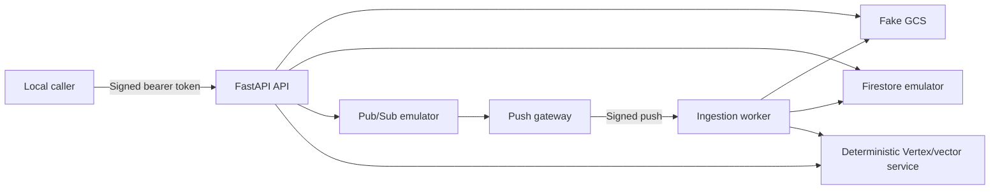

# Run locally with Docker Compose

The local environment runs the complete API and ingestion path without Google
Cloud credentials or billable calls.

## Prerequisites

- Docker with Compose v2
- `uv`
- Python 3.12
- Ports `4443`, `8080`, `8081`, `8082`, `8085`, and `8090` available on
  `127.0.0.1`

## Start

```bash
uv python install 3.12
uv sync --frozen --all-groups
make check
make local-run
```

`run.sh` builds and starts the stack, seeds a Markdown document into fake GCS,
and executes the end-to-end smoke test.

To run each step separately:

```bash
docker compose -f local/compose.yaml up --build --wait
python3 local/scripts/seed.py
python3 local/scripts/smoke.py
```

Run the smoke test a second time to verify idempotent replay:

```bash
python3 local/scripts/smoke.py
```

Stop the stack and delete local volumes:

```bash
make local-down
```

## Services

| Service | Host address | Purpose |
|---|---|---|
| API | `http://127.0.0.1:8080` | Document registration, status, deletion, and grounded queries |
| Worker | `http://127.0.0.1:8081` | Private ingestion endpoint |
| Firestore emulator | `127.0.0.1:8082` | Documents, chunks, leases, and idempotency |
| Pub/Sub emulator | `127.0.0.1:8085` | Ingestion topic, push subscription, and local DLQ setup |
| Fake GCS | `http://127.0.0.1:4443` | Canonical source documents |
| Local Vertex service | `http://127.0.0.1:8090` | Deterministic embeddings, vectors, and generation |
| Push gateway | Compose network only | Adds local signed authentication to emulator push requests |

All published host ports bind to loopback. API and worker containers have
Google metadata and public Google API endpoints blocked and do not receive
Application Default Credentials.

## Architecture



## What the smoke test proves

1. Anonymous query access is denied.
2. Vector search rejects missing tenant, corpus, index, or generation filters.
3. A managed object is registered and delivered through Pub/Sub push.
4. The worker parses, chunks, embeds, indexes, and marks the document `READY`.
5. Duplicate registration preserves the same lifecycle generation.
6. A supported question returns a citation.
7. An unsupported question abstains.
8. Delete creates an immediate tombstone and blocks later retrieval.

## Troubleshooting

Inspect status and logs:

```bash
docker compose -f local/compose.yaml ps
docker compose -f local/compose.yaml logs api worker push-gateway
```

Reset stale emulator state before retrying:

```bash
make local-down
make local-up
```

`/healthz` checks process liveness. `/readyz` checks configuration and required
dependency wiring.
