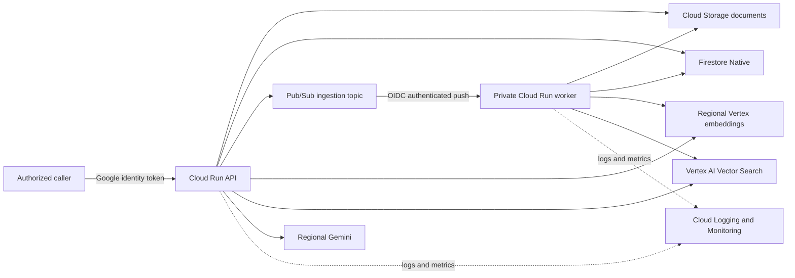

# Run on Google Cloud

## Current status

The application contains GCP adapters, production container images, and
fail-closed GCP configuration validation. The repository does **not** currently
contain Terraform or Cloud Build deployment definitions, so it is not yet
deployable to GCP from a documented command. Do not deploy it manually and call
that production-ready.

The target described here is a single-region development deployment. It is not
HA, DR-ready, compliance-certified, or production multitenant.

## Required Google Cloud services

| Service | Purpose |
|---|---|
| Cloud Run | Separate IAM-protected API and private ingestion worker |
| Cloud Storage | Canonical source document bucket and Terraform state bucket |
| Firestore Native | Document state, chunks, leases, idempotency, and active-index metadata |
| Pub/Sub | Ingestion topic, authenticated push subscription, retries, and DLQ |
| Vertex AI embeddings | Regional query and document embeddings |
| Vertex AI Vector Search | Streaming vector index, endpoint, and deployed index |
| Vertex AI Gemini | Regional grounded answer generation |
| Artifact Registry | Immutable API and worker images |
| Cloud Build | Test, build, scan, push, plan, and controlled deployment |
| Cloud Logging and Monitoring | Structured logs, metrics, dashboards, and alerts |
| Cloud Billing budgets | Development spend notifications; budgets do not stop spend |

## Architecture



## Runtime identities

Use separate service accounts:

- API runtime: read/write document metadata, read chunks and managed objects,
  publish ingestion messages, and call the selected Vertex services.
- Worker runtime: read canonical objects, update Firestore records and chunks,
  and mutate/query the selected Vector Search index.
- Pub/Sub push: only `run.invoker` on the worker.
- Cloud Build: build/push images and impersonate approved deployment/runtime
  identities; no corpus access.
- Terraform deployment: infrastructure permissions only.

Never use default compute identities, service-account keys, `allUsers`, or
`allAuthenticatedUsers`.

## Required configuration

GCP mode must use:

```text
APP_MODE=gcp
AUTH_MODE=cloud_run_iam
GCP_PROJECT_ID
GCP_REGION
TF_STATE_PROJECT_ID
TF_STATE_BUCKET_NAME
TF_STATE_BUCKET_LOCATION
ARTIFACT_REGISTRY_REPOSITORY
DEV_TENANT_ID
DEV_OPERATOR_GROUP
ALERT_EMAIL
BUDGET_AMOUNT_USD
GCS_DOCUMENT_BUCKET
TENANT_UPLOAD_PREFIX
FIXED_CORPUS
PUBSUB_WORKER_AUDIENCE
GENERATION_MODEL_ID
EMBEDDING_MODEL_ID
EMBEDDING_DIMENSIONS
VECTOR_SEARCH_SHARD_SIZE
LOG_RETENTION_DAYS
SOURCE_REPOSITORY
```

Model IDs must be pinned GA versions available in `GCP_REGION`. GCP mode must
not set any `LOCAL_*_ENDPOINT` or local signing-key setting.

## Deployment sequence to implement

1. Add Terraform bootstrap for a private, versioned, protected GCS state
   bucket.
2. Add Terraform for APIs, service accounts, least-privilege IAM, Artifact
   Registry, canonical GCS, Firestore, Pub/Sub/DLQ, Vector Search, Cloud Run,
   monitoring, and budget alerts.
3. Add Cloud Build CI that runs `make check`, Terraform validation/security
   scans, container builds, and image vulnerability scans.
4. Build API and worker images once, push immutable digests, and pass those
   digests to Terraform.
5. Review the Terraform plan and require explicit approval before apply.
6. Apply through the deployment identity. Terraform remains the source of
   truth for Cloud Run configuration.
7. Invoke the API with a Google identity token and run the same ingestion,
   citation, abstention, deletion, and unauthenticated-denial checks used
   locally.
8. Verify logs, dashboard data, alerts, budget notifications, rollback, and a
   destroy plan.

Until these deployment files and checks exist, the supported execution path is
the Docker Compose environment in
[`local-development.md`](local-development.md).

## Runtime flow

Document ingestion:

1. Upload an accepted object below the fixed tenant prefix in the canonical
   bucket.
2. Call `POST /v1/documents` with its immutable GCS generation and checksum.
3. The API writes `PENDING` and publishes a content-free ingestion event.
4. Pub/Sub invokes the worker with OIDC authentication.
5. The worker parses, chunks, embeds, stages metadata, upserts vectors, verifies
   the index, and marks the matching generation `READY`.

Query:

1. Invoke `POST /v1/query` with a Google identity token.
2. The API embeds the question and queries Vector Search with mandatory tenant,
   corpus, active-generation, and index restrictions.
3. Firestore hydration re-authorizes every candidate.
4. Gemini receives only authorized evidence.
5. Unsupported evidence causes explicit abstention; returned citations are
   verified against hydrated chunks.

## Standing-cost warning

Cloud Run can scale to zero, but a deployed Vector Search endpoint has
non-zero standing cost. Budgets only notify; they do not stop spending.
